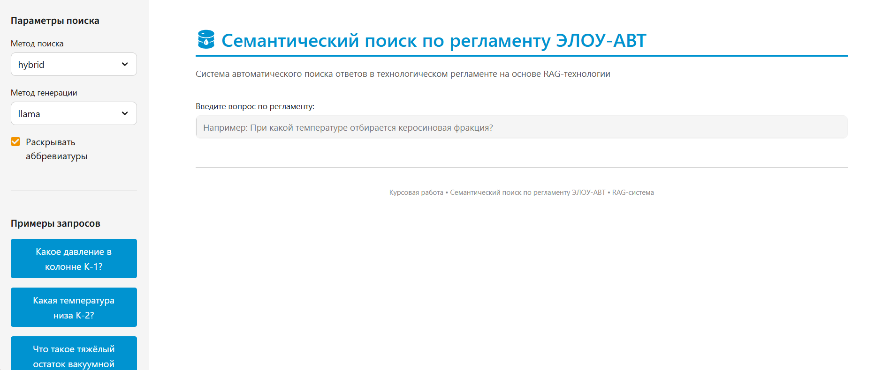
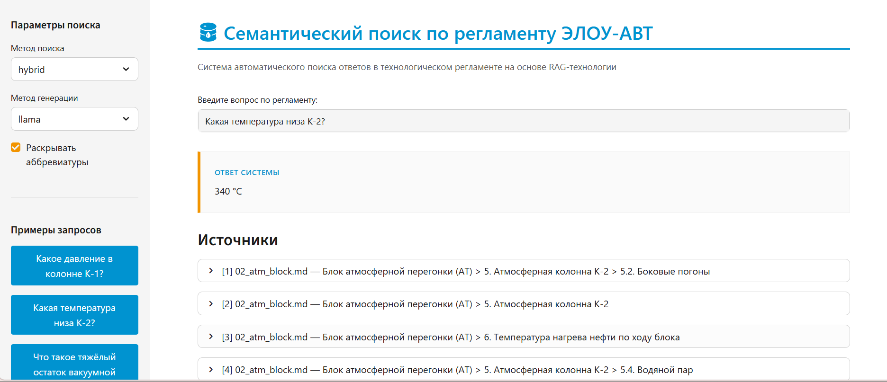
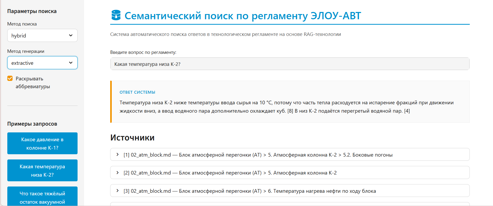
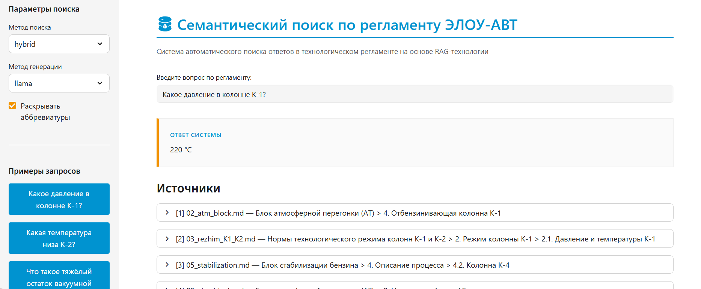

# Развертывание (деплой) и особенности работы RAG-системы в облачной среде

## 1. Архитектура развертывания

Прототип RAG-системы развернут на облачной платформе **Streamlit Community Cloud**. Выбор данной платформы обусловлен необходимостью обеспечить публичный доступ к веб-интерфейсу приложения без развертывания собственной серверной инфраструктуры и настройки отдельного удаленного сервера.

Размещение приложения в облачной среде позволяет пользователям взаимодействовать с системой через браузер, не устанавливая дополнительные библиотеки и программное обеспечение на локальный компьютер.
Работающая версия RAG-системы доступна по следующей ссылке: [rag-elou-avt-project](https://rag-elou-avt-project-nm7pjk2z77xpvdhkbuyifd.streamlit.app/)

### 1.1. Особенности конфигурации деплоя

При развертывании приложения используются следующие технические решения:

- **Операционная среда:** Linux (Debian), Python 3.14.
- **Установка вычислительно-зависимых библиотек:** библиотека `llama-cpp-python`, требующая компиляции нативного C++ кода, устанавливается с использованием предварительно скомпилированного бинарного пакета (wheel), совместимого с облачной средой. Это позволяет избежать дополнительной компиляции непосредственно во время развертывания приложения.
- **Загрузка языковой модели:** для ограничения размера репозитория GitHub веса квантованной языковой модели в формате GGUF не хранятся непосредственно в репозитории. Вместо этого они загружаются с платформы Hugging Face Hub по мере необходимости с использованием функции `hf_hub_download` из библиотеки `huggingface_hub`.
- **Кэширование моделей:** для предотвращения повторной загрузки и инициализации ресурсоемких компонентов используются декораторы `@st.cache_resource`. Благодаря этому модели эмбеддингов, генеративная языковая модель и другие ресурсоемкие объекты переиспользуются между взаимодействиями пользователя с приложением в течение времени жизни соответствующего контейнера.

Таким образом, выбранная архитектура позволяет минимизировать размер репозитория, упростить процесс развертывания и сократить время повторной инициализации основных компонентов системы.

## 2. Пользовательский сценарий работы

Пользовательский интерфейс реализован с использованием библиотеки Streamlit. Он предоставляет возможность настройки параметров поиска, выбора метода генерации ответа и просмотра найденных источников информации.

### 2.1. Основные элементы интерфейса

Интерфейс приложения включает следующие компоненты:

1. **Боковая панель настройки (Sidebar).** Предоставляет возможность выбора метода поиска (`hybrid`, `bm25`, `dense`), метода генерации ответа (`extractive` или `llama`), а также включения функции раскрытия аббревиатур. Количество извлекаемых фрагментов контекста (параметр `k`) зафиксировано на значении 10 в соответствии с требованиями технического задания.

2. **Поле ввода запроса и примеры вопросов.** Пользователь может сформулировать собственный запрос либо воспользоваться заранее подготовленными примерами, предназначенными для демонстрации основных возможностей системы.

3. **Блок генерации ответа.** Отображает итоговый ответ на пользовательский запрос. В зависимости от выбранного метода генерации ответ формируется либо генеративной языковой моделью на основе найденного контекста, либо экстрактивным алгоритмом извлечения наиболее релевантных предложений.

4. **Блок источников.** Представлен в виде раскрывающихся элементов (`expander`), содержащих найденные фрагменты документов, соответствующие метаданные, сведения о принадлежности к документу и разделу, а также показатели релевантности.

### 2.2. Демонстрация пользовательского интерфейса

На рисунке 1 представлен общий вид веб-интерфейса приложения, включая боковую панель с настройками и поле ввода пользовательского запроса.

*Рисунок 1 — Главная страница RAG-системы.*

На рисунке 2 представлен пример взаимодействия пользователя с системой: ввод вопроса и получение ответа с использованием генеративной языковой модели.

*Рисунок 2 — Пример ответа, сформированного генеративной моделью.*

На рисунке 3 показан результат работы экстрактивного метода генерации, при котором система извлекает наиболее релевантные предложения из найденных фрагментов документов.

*Рисунок 3 — Пример ответа с использованием экстрактивного подхода.*

### 2.3. Выявленная проблема корректности ответов системы

В ходе тестирования RAG-системы был выявлен случай некорректного формирования ответа на вопрос о рабочем давлении в колонне К-1 установки ЭЛОУ-АВТ.

При вводе вопроса «Какое давление в колонне К-1?» система сформировала следующий ответ:

> 220 °C

*Рисунок 4 — Пример неверного ответа.*

Данный ответ является некорректным, поскольку вместо запрашиваемого параметра давления система вывела значение температуры низа колонны К-1. Согласно технологическому описанию, температура низа колонны составляет 220 °C, тогда как значение рабочего давления в предоставленном фрагменте документации отсутствует.

Для повышения достоверности ответов необходимо предусмотреть дополнительный контроль соответствия генерируемой информации найденным источникам. Если в документации отсутствуют необходимые сведения, система должна сообщать об этом пользователю, а не подставлять предположительные числовые значения.

## 3. Особенности работы и ограничения облачной среды

В процессе эксплуатации прототипа в облачной среде были выявлены ограничения бесплатного тарифного плана Streamlit Community Cloud, оказывающие влияние на стабильность работы, скорость обработки запросов и доступность приложения.

### 3.1. Ограничения вычислительных ресурсов и перезапуск приложения

Необходимость периодического перезапуска приложения обусловлена особенностями облачной инфраструктуры и ограничениями выделяемых вычислительных ресурсов.

Основные факторы:

- **Ограничение оперативной памяти (RAM).** Бесплатный тариф предоставляет ограниченный объем оперативной памяти (около 1 ГБ в используемой конфигурации). Одновременное использование модели эмбеддингов, индекса FAISS и квантованной генеративной языковой модели требует значительного объема памяти. При превышении доступного лимита приложение может быть принудительно остановлено системой вследствие ошибки Out-of-Memory (OOM).
- **Автоматическое приостановление приложения.** При отсутствии пользовательской активности облачная платформа может переводить приложение в состояние сна. После возобновления работы возникает эффект холодного старта (cold start), сопровождающийся повторной инициализацией среды, загрузкой библиотек и, при необходимости, скачиванием весов моделей.

В результате первый запрос после периода неактивности может обрабатываться значительно дольше последующих. Для обеспечения стабильной демонстрации рекомендуется заранее активировать приложение и выполнить тестовый запрос, чтобы основные компоненты системы были загружены.

### 3.2. Задержка генерации ответов

Время обработки пользовательского запроса зависит от выбранного алгоритма формирования ответа и доступных вычислительных ресурсов.

**Генеративный режим (`llama`).**

Наблюдаемое время генерации ответа составляет приблизительно 40–60 секунд. Основной причиной задержки является выполнение инференса языковой модели на CPU в условиях ограниченных вычислительных ресурсов облачного окружения.

При интенсивном использовании процессорного времени платформа может применять механизм ограничения нагрузки, сопровождающийся предупреждением `Your app has been throttled`.

Несмотря на относительно высокую задержку, данный режим обеспечивает формирование связного текстового ответа, позволяющего объединять информацию из нескольких найденных фрагментов контекста. Это особенно важно при обработке процедурных и составных запросов, требующих синтеза информации.

**Экстрактивный режим (`extractive`).**

Наблюдаемое время обработки запроса составляет менее одной секунды. В отличие от генеративного подхода, данный режим не создает новый текст, а извлекает наиболее релевантные предложения непосредственно из найденных документов.

Преимуществом метода является высокая скорость обработки. Однако итоговый ответ может быть менее связным, содержать избыточные фрагменты исходного текста или представлять собой набор отдельных предложений, не объединенных в единое повествование.

### 3.3. Сравнение методов генерации

Для оценки особенностей двух реализованных подходов было проведено сравнение по основным характеристикам.

| Критерий | `llama` | `extractive` |
|---|---|---|
| Принцип работы | Генерация нового текста на основе контекста | Извлечение предложений из найденных фрагментов |
| Скорость ответа | 40–60 секунд | Менее 1 секунды |
| Связность текста | Высокая | Может быть фрагментарной |
| Синтез информации | Объединяет данные из разных фрагментов | Преимущественно воспроизводит исходные предложения |
| Основное преимущество | Качество и естественность ответа | Скорость и низкие вычислительные затраты |
| Основной недостаток | Высокая вычислительная нагрузка | Ограниченная связность и отсутствие полноценного синтеза |

Сравнение показывает, что между качеством формируемого ответа и скоростью его получения существует компромисс. Генеративный режим обеспечивает более естественное представление информации, тогда как экстрактивный режим позволяет получать результат практически мгновенно.

### 3.4. Возможность перехода на API-модель генерации

Текущая реализация системы предусматривает локальный запуск квантованной языковой модели непосредственно в облачном контейнере Streamlit. Такой подход обеспечивает автономность генерации ответов от сторонних сервисов, однако требует значительных вычислительных ресурсов, включая оперативную память и процессорное время.

В качестве перспективного направления развития системы рассматривается переход на использование внешних API языковых моделей. В данном случае генерация ответов будет выполняться на стороне удаленного сервиса, а облачное приложение будет отправлять ему сформированный контекст, пользовательский запрос и параметры генерации.

Это позволит исключить необходимость загрузки и хранения весов генеративной модели в контейнере Streamlit, существенно снизить потребление оперативной памяти и уменьшить нагрузку на CPU.

При этом основная RAG-инфраструктура, включающая обработку документов, формирование эмбеддингов, индексацию, а также поиск релевантных фрагментов с использованием BM25, Dense Retrieval или Hybrid Search, может остаться без изменений. Таким образом, замена генеративного компонента не потребует существенной переработки основной логики поиска и извлечения контекста.

Дополнительным преимуществом данного подхода является возможность гибкой замены используемых языковых моделей в зависимости от требований к качеству генерации, скорости ответа и стоимости обработки запросов. Например, можно использовать API таких провайдеров, как OpenAI или xAI (Grok), при условии наличия соответствующего доступа.

Вместе с тем использование внешних API предполагает зависимость от доступности стороннего сервиса, сетевого соединения, тарифов на обработку запросов и требований к конфиденциальности передаваемых данных. Для безопасного использования API-ключи должны храниться в защищенных настройках приложения (Streamlit Secrets), а не в открытом исходном коде или репозитории GitHub.

Таким образом, переход к API-модели генерации является перспективным направлением оптимизации разработанного прототипа. Он позволит сохранить существующую архитектуру RAG-системы, одновременно повысив производительность, надежность и возможности дальнейшего масштабирования приложения.

## 4. Выводы

Развертывание RAG-прототипа на платформе Streamlit Community Cloud позволило обеспечить публичный доступ к системе и продемонстрировать ее функциональность без использования отдельного серверного оборудования. Использование удаленного хранения весов модели, кэширования ресурсоемких компонентов и предварительно скомпилированных библиотек упростило процесс развертывания и оптимизировало использование ресурсов облачной среды.

В ходе эксплуатации были выявлены ограничения бесплатного тарифного плана, связанные с объемом оперативной памяти, производительностью CPU и механизмом автоматического приостановления приложения. Эти факторы непосредственно влияют на время обработки запросов и стабильность работы системы.

Сравнение генеративного и экстрактивного методов показало наличие компромисса между качеством формируемого ответа и скоростью его получения. Экстрактивный подход обеспечивает минимальную задержку и может использоваться в качестве базового метода сравнения (baseline), тогда как генеративный режим `llama` позволяет получать более связные и информативные ответы за счет синтеза информации из нескольких фрагментов контекста.

Для демонстрации возможностей RAG-архитектуры и оценки качества синтеза информации предпочтительным является генеративный режим. Экстрактивный режим целесообразно использовать в качестве быстрого базового решения.

В качестве дальнейшего направления развития системы рассматривается переход на использование внешних API языковых моделей. Это позволит снизить требования к вычислительным ресурсам облачной платформы, сократить задержки генерации и упростить масштабирование приложения без изменения основной поисковой архитектуры.

Таким образом, разработанный прототип демонстрирует работоспособность RAG-системы в облачной среде, поддерживает различные стратегии поиска и формирования ответов, а также предусматривает возможности дальнейшей оптимизации и расширения функциональности.
